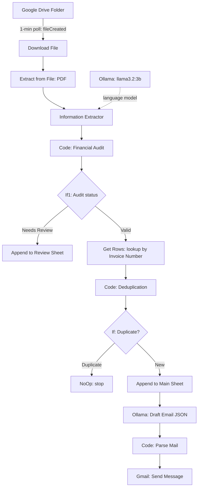

# Local AI-Powered Automated Invoice Processing & Verification Pipeline

An event-driven **n8n** workflow that monitors Google Drive for incoming PDF invoices, extracts structured data with a local LLM (`llama3.2:3b` via **Ollama**), audits the math, detects duplicates, logs valid records to Google Sheets, and sends HTML notification emails through Gmail.

**Category:** Intelligent Document Processing (IDP) / Enterprise Financial Automation

---

## Table of Contents

1. [Project Overview](#1-project-overview)
2. [Problem Statement](#2-problem-statement)
3. [Proposed Solution](#3-proposed-solution)
4. [System Architecture](#4-system-architecture)
5. [Technologies & Tools](#5-technologies--tools)
6. [Workflow Execution](#6-workflow-execution)
7. [Core Features](#7-core-features)
8. [AI Implementation](#8-ai-implementation)
9. [Data Flow](#9-data-flow)
10. [Error Handling & Validation](#10-error-handling--validation)
11. [Challenges & Technical Solutions](#11-challenges--technical-solutions)
12. [Business Value](#12-business-value)
13. [Limitations & Future Improvements](#13-limitations--future-improvements)
14. [Technical Project Summary](#14-technical-project-summary)
15. [Setup & Deployment](#15-setup--deployment)

---

## 1. Project Overview

| Item | Details |
|------|---------|
| **Project Name** | Local AI-Powered Automated Invoice Processing & Verification Pipeline |
| **Category** | Intelligent Document Processing (IDP) / Enterprise Financial Automation |
| **Description** | An event-driven n8n workflow that monitors Google Drive for incoming PDF invoices, extracts structured financial data using a local LLM (`llama3.2:3b` via Ollama), performs automated recalculation and duplicate detection, logs valid records to Google Sheets, and sends HTML notification emails via Gmail. |
| **Main Purpose** | Automate the invoice intake lifecycle (PDF parsing, validation, deduplication, cloud logging, and internal billing notifications) without sending invoice content to public cloud AI endpoints. |
| **Target Users** | Accounts Payable (AP) departments, billing teams, finance managers, and privacy-conscious organizations seeking cost-effective document processing. |

---

## 2. Problem Statement

Manual processing of vendor invoices creates operational bottlenecks:

- **High manual overhead:** AP staff spend hours transcribing PDF data into spreadsheet ledgers or ERP systems.
- **Financial risk & errors:** Transcription mistakes lead to miscalculated totals, unverified line items, and accidental payment of duplicate invoices.
- **Privacy & cost concerns:** Public cloud AI APIs (e.g., OpenAI) for OCR and extraction incur per-token costs and raise compliance concerns for sensitive financial records.

---

## 3. Proposed Solution

A self-hosted, automated pipeline that picks up newly uploaded PDF invoices:

1. **Automated document ingestion:** Polls a designated Google Drive folder (`<drive-folder-id>`) every minute, then downloads each new PDF and extracts its text.
2. **Local AI extraction:** A LangChain Information Extractor powered by `llama3.2:3b` (via Ollama) extracts 10 schema attributes (invoice number, supplier ID, subtotal, total due, line items, etc.).
3. **Financial audit logic:** Custom JavaScript computes `subtotal + shipping_and_handling` and compares it to the total due (tolerance: $0.05). Mismatches are tagged `Needs Review ⚠️` and routed to a review tab.
4. **Deduplication check:** Looks up existing ledger rows by `Invoice Number`. If a match exists, the invoice is flagged `Duplicate ⚠️` and execution stops at a `NoOp` node.
5. **Ledger ingestion & emailing:** Appends valid, non-duplicate invoices to the main Google Sheet (`<spreadsheet-id>`), prompts the local LLM to write an HTML email, and sends it to internal billing staff (`<billing-email>`).

---

## 4. System Architecture

### Overview

A multi-stage conditional pipeline with two branch points (financial discrepancy routing and duplicate routing):

- **Trigger:** `n8n-nodes-base.googleDriveTrigger` (v1), event `fileCreated`, 1-minute polling.
- **Extraction layer:** `n8n-nodes-base.extractFromFile` (PDF) plus `@n8n/n8n-nodes-langchain.informationExtractor` (v1.2) powered by `@n8n/n8n-nodes-langchain.lmOllama` (`llama3.2:3b`).
- **Validation engine:** JavaScript nodes (`Code in JavaScript1` for the financial audit, `Code in JavaScript2` for duplicate verification).
- **Control flow:** `If1` (financial review branch) and `If` (duplicate branch).
- **Persistence & alerting:** `n8n-nodes-base.googleSheets` (v4.7), `@n8n/n8n-nodes-langchain.ollama` (`Message a model`), and `n8n-nodes-base.gmail` (v2.2).

### Architecture Diagram



### ASCII View

```text
[ Google Drive Folder ] ──( 1-Min Poll: fileCreated )──► [ Download File Node ]
                                                                   │
                                                                   ▼
                                                       [ Extract from File (PDF) ]
                                                                   │
                                                                   ▼
[ Ollama (llama3.2:3b) ] ◄──( System Prompt / Schema )───► [ Information Extractor ]
                                                                   │
                                                                   ▼
                                                       [ Code: Financial Audit ]
                                                        (Calculates: Subtotal+Shipping)
                                                                   │
                                                                   ▼
                                                          [ If1 Node (Audit Status) ]
                                                            │                   │
                                          (Needs Review ⚠️) │                   │ (Valid ✅)
                                                            ▼                   ▼
                                                [ Append to Review Sheet ]   [ Get Rows from Sheet ]
                                                                                (Lookup by Invoice #)
                                                                                        │
                                                                                        ▼
                                                                             [ Code: Deduplication ]
                                                                                        │
                                                                                        ▼
                                                                              [ If Node (Duplicate?) ]
                                                                                │                │
                                                                 (Duplicate ⚠️) │                │ (New ✅)
                                                                                ▼                ▼
                                                                           [ NoOp Node ]  [ Append to Sheet ]
                                                                                                 │
                                                                                                 ▼
                                                                                      [ Ollama: Draft Email ]
                                                                                       (JSON: Subject & Body)
                                                                                                 │
                                                                                                 ▼
                                                                                      [ Code: Parse Mail JS ]
                                                                                                 │
                                                                                                 ▼
                                                                                      [ Gmail: Send Message ]
```

---

## 5. Technologies & Tools

| Technology | Role in Project | Why Used (Implementation Evidence) |
|------------|-----------------|------------------------------------|
| **n8n** | Workflow orchestrator | Connects file triggers, local LLM chains, conditional routers, and external APIs. |
| **Google Drive API** | Ingestion source | Monitors folder `<drive-folder-id>` for incoming PDF uploads. |
| **Extract from File (n8n)** | File parsing engine | Converts binary PDF invoice data into plain text for the LLM. |
| **LangChain Information Extractor** | Schema extractor | Maps raw text into structured JSON matching the predefined invoice schema. |
| **Ollama (`llama3.2:3b`)** | Local LLM engine | Provides zero-cost extraction and natural-language HTML email generation on your own hardware. |
| **JavaScript (Node.js)** | Validation logic | Performs float arithmetic audits, duplicate search, and email payload formatting. |
| **Google Sheets API** | Data ledger sink | Appends verified records to the `Invoices` spreadsheet (`<spreadsheet-id>`). |
| **Gmail API** | Notification dispatcher | Sends automated HTML status emails to `<billing-email>`. |

---

## 6. Workflow Execution

```text
[ Drive Trigger ] ──► [ Download PDF ] ──► [ Extract Text ] ──► [ Information Extractor (Ollama) ]
                                                                              │
                                                                              ▼
                                                                  [ Financial Audit Logic ]
                                                                              │
                                                                              ▼
                                                                    [ Deduplication Check ]
                                                                              │
                                                                              ▼
[ Gmail Dispatch ] ◄── [ Draft HTML Email ] ◄─────────────────────── [ Append Row ]
```

### Step 1: Ingestion & Text Extraction

- **Components:** Google Drive Trigger, Download file, Extract from File.
- **Process:** Checks the monitored Drive folder every minute. When a new file appears, it downloads the binary and extracts the raw text (`$json.text`).

### Step 2: AI Structured Extraction

- **Components:** Information Extractor with the Ollama model (`llama3.2:3b`).
- **Process:** Sends the text to `llama3.2:3b` with instructions to populate the target schema:
  `invoice_number`, `invoice_date`, `due_date`, `supplier_name`, `supplier_id`, `customer_name`, `subtotal`, `shipping_and_handling`, `total_amount_due`, `items_details`.

### Step 3: Financial Verification & Audit

- **Component:** `Code in JavaScript1`
- **Logic:**

  ```javascript
  const calculatedTotal = subtotal + shipping;
  const difference = Math.abs(calculatedTotal - totalDue);
  const status = (!hasRequiredValues || difference > 0.05) ? 'Needs Review ⚠️' : 'Valid ✅';
  ```

- **Routing (node `If1`):**
  - **Needs Review ⚠️:** Appended to `Append row in sheet1` with audit notes (calculated total and difference) for human inspection.
  - **Valid ✅:** Passed on to duplicate checking.

### Step 4: Duplicate Verification

- **Components:** Get row(s) in sheet, `Code in JavaScript2`, `If`.
- **Logic:** Queries Google Sheets by the extracted invoice number; JavaScript checks whether any returned row matches.
  - **Duplicate (`isDuplicate === true`):** Routed to `No Operation, do nothing`; the workflow ends without writing.
  - **New:** Routed to `Append row in sheet`.

### Step 5: Notification Drafting & Dispatch

- **Components:** Message a model (Ollama), `Code in JavaScript`, Send a message (Gmail).
- **Process:** Prompts `llama3.2:3b` to act as a billing email writer (`<your-name>` from `<your-company>`), producing an HTML notification with the sheet URL and invoice summary as JSON: `{"subjectLine": "...", "EmailBody": "..."}`. The code node parses that JSON, and Gmail OAuth2 sends the email.

---

## 7. Core Features

- **Local AI extraction:** Runs on a self-hosted `llama3.2:3b` model via Ollama, so invoice text is not sent to a cloud LLM API.
- **Automated math audit:** Compares `subtotal + shipping_and_handling` against `total_amount_due` with a tolerance of `$0.05`.
- **Built-in deduplication:** Reads existing records before writing, to prevent duplicate billing entries.
- **Exception handling:** Routes inconsistent invoices to a review state with calculated difference notes.
- **Dynamic HTML notification:** Combines LLM-written text with programmatic fallbacks to email the AP team after each ledger update.

---

## 8. AI Implementation

| Aspect | Details |
|--------|---------|
| **Model** | `llama3.2:3b` running locally via Ollama |
| **Responsibilities** | (1) Document data extraction via the LangChain Information Extractor. (2) Notification synthesis: generating HTML email text from invoice variables. |
| **Extractor prompt** | System prompt framing the model as an extraction algorithm that only pulls relevant information from the text. |
| **Email prompt** | Instructs the model to act as a billing agent, return strict JSON (`{"subjectLine":"...", "EmailBody":"..."}`), and write the body in HTML without Markdown wrappers. |
| **Limitations** | 3B models can misread complex tables or drop minor fields when PDF text is noisy. |

---

## 9. Data Flow

```text
[ PDF Upload on Google Drive ]
        │
        ▼
[ Extract PDF Text ]
        │
        ▼
[ Information Extractor (llama3.2:3b) ]
        │
        ▼ Parsed Attributes (JSON)
[ JavaScript Financial Audit ]
        │
        ├──► (Audit Failed / Difference > 0.05) ──► [ Append to Google Sheets (Review) ]
        │
        └──► (Audit Passed) ──► [ Google Sheets Lookup (Invoice Number) ]
                                            │
                                            ▼
                                  [ JavaScript Deduplication ]
                                            │
                                            ├──► (Duplicate Found) ──► [ NoOp / Stop ]
                                            │
                                            └──► (New Invoice) ─────► [ Append to Primary Sheet ]
                                                                                   │
                                                                                   ▼
                                                                     [ Ollama HTML Email Generation ]
                                                                                   │
                                                                                   ▼
                                                                        [ Send Email via Gmail ]
```

---

## 10. Error Handling & Validation

- **Mathematical validation:** Detects missing fields and discrepancies above `$0.05`. Flagged rows are stored with `Review Status: Needs Review ⚠️` and calculation notes.
- **Duplicate prevention:** Compares extracted invoice IDs with existing sheet rows; duplicates stop at the `NoOp` node.
- **JavaScript fallbacks:** If the LLM omits the customer name or invoice number while drafting the email, the code node falls back to defaults (`'Valued Customer'`, `'N/A'`).
- **Type conversion guardrails:** `attemptToConvertTypes: false` on the Google Sheets nodes preserves raw strings (e.g., prevents leading-zero loss in invoice IDs).

---

## 11. Challenges & Technical Solutions

| Challenge | Solution |
|-----------|----------|
| LLM hallucination or omission when parsing raw PDF text. | Defined explicit field descriptions and data types in the Information Extractor schema, plus a strict system prompt. |
| Duplicate entries from re-uploaded PDFs or multi-page scans. | Added a pre-write lookup (Get row(s) in sheet) with a custom JavaScript duplicate checker (`Code in JavaScript2`). |
| Handling invalid calculations without stopping the pipeline. | Added an exception branch (`If1`) that sends bad invoices to a review flow while valid ones continue. |

---

## 12. Business Value

- **Data privacy:** Invoice text is parsed on your own hardware by a self-hosted model instead of a public LLM API. (Stored records and notifications still pass through Google Sheets and Gmail.)
- **Zero inference costs:** No per-document fees from cloud OCR/LLM APIs.
- **Fewer duplicate payments:** The invoice number lookup catches repeat vendor submissions before payment approval.
- **Reduced audit time:** Calculation discrepancies are flagged automatically, so AP reviews only problem invoices.

---

## 13. Limitations & Future Improvements

### Current Limitations

- **PDF format dependency:** Needs digital-text PDFs (`n8n-nodes-base.extractFromFile`). Scanned image PDFs need an OCR step first (e.g., Tesseract or PaddleOCR).
- **Hardcoded email recipient:** The notification address is static in the node parameters.
- **Polling latency:** Uses a 1-minute poll instead of instant push notifications for Drive uploads.
- **Float arithmetic:** Totals are compared as floating-point numbers; the `$0.05` tolerance absorbs rounding, but currency values are not handled as integer cents.

### Planned Enhancements

- [ ] **Vision-based extraction:** Move to a multimodal local model (e.g., `llama3.2-vision` or `qwen2-vl`) to read scanned invoices directly.
- [ ] **Dynamic routing:** Choose notification recipients based on the extracted `supplier_name` or `customer_name`.
- [ ] **Database scaling:** Move storage from Google Sheets to PostgreSQL or MySQL.

---

## 14. Technical Project Summary

An event-driven invoice processing pipeline built in n8n. It detects PDF uploads on Google Drive, extracts key financial metadata with a local `llama3.2:3b` model via Ollama, audits totals and detects duplicates with custom JavaScript, logs records to Google Sheets, and sends HTML email updates via Gmail.

---

## 15. Setup & Deployment

### Prerequisites

Pull the required Ollama model:

```bash
ollama pull llama3.2:3b
```

### Deployment Steps

1. **Import the workflow:** Load `workflow.json` into your n8n workspace.
2. **Configure credentials:**
   - Google Drive OAuth2
   - Google Sheets OAuth2
   - Gmail OAuth2
   - Ollama API (default: `http://localhost:11434`)
3. **Update identifiers:**
   - Set `folderToWatch` in the Google Drive Trigger node.
   - Set `documentId` in the Google Sheets nodes.
   - Set the recipient address in the Gmail node.
4. **Prepare the sheet:** Create the ledger and review tabs with column headers matching the workflow's field mapping.
5. **Activate:** Set the workflow to Active.

> **Note:** If n8n runs in Docker, `localhost` points to the container. Use `http://host.docker.internal:11434` (or your Ollama container's hostname) for the Ollama credential.

### Tech Stack

- **Orchestration:** n8n Workflow Automation
- **AI infrastructure:** Ollama (`llama3.2:3b`) via LangChain integration
- **Integrations:** Google Drive API, Google Sheets API, Gmail API
- **Scripting:** JavaScript (Node.js runtime in n8n Code nodes)
